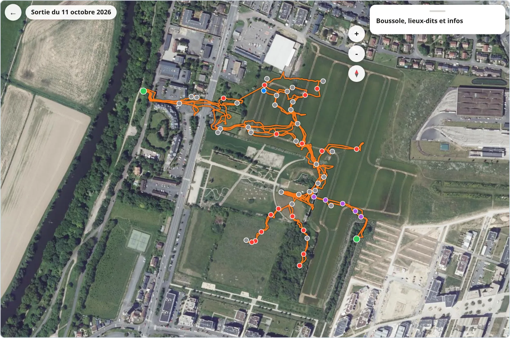

# Ariane Maps

A static site for sharing underground quarry surveys exported as SVG from Ariane. Plans can be viewed on their own or aligned with IGN aerial imagery and LiDAR relief.

**Warning.** These maps are surveyed with a pedometer and compass using an experimental application: errors of several tens of metres are possible. They do not replace a map, reference points or caution. Access to underground quarries is often prohibited and always dangerous.

<picture>
  <source media="(prefers-color-scheme: dark)" srcset=".github/assets/screenshot-dark.webp">
  
</picture>

[Website](https://kitoutou999.github.io/ariane-cartes/)

## Viewing maps

- Georeferenced surveys can use IGN aerial imagery, LiDAR relief, IGN maps or OpenStreetMap. IGN layers cover France.
- Plans without GPS control points use a dark background and a 10 m grid, with north at the top.
- Select a landmark to mark your current location or choose a destination. The viewer shows distance and bearing.
- On a phone, enable the compass and accept sensor access. On iPhone, the permission request requires a tap. There is no GPS underground: select the landmark where you are.
- The cone shows the phone's heading; the arrow points toward the chosen landmark and shows the turn angle. Hold the phone flat and away from metal. Plan north is magnetic north, as used by the compass.
- Oriented-map mode rotates the map with the phone. Dragging is disabled while zoom remains available.
- Download the published SVG to open it in another viewer. Light and dark interface themes follow the browser setting.

## Getting started

Requires Node.js and Python 3. No npm dependencies are needed; Leaflet loads from a CDN.

```sh
node scripts/index.js
python3 -m http.server 8000
```

Open http://localhost:8000/. The index command generates `cartes/index.json` from the SVG files in `cartes/`. Compass access requires HTTPS or localhost and a phone with orientation sensors.

## Adding a map

In Ariane, open Settings, My outings, select an outing, prepare exports and share the SVG map.

- For a plan without geographic alignment, open the repository's [new-map form](https://github.com/kitoutou999/ariane-cartes/issues/new?template=nouvelle-carte.yml), put the name after `Carte :` in the title and attach the SVG.
- Alternatively, open `ajouter.html` and enter a title, author, location and description. Optionally associate landmarks with GPS coordinates measured above ground: one point translates the plan, two set its scale and rotation, and three or more allow network adjustment along the trace. Revisited landmarks remain joined.
- Download the prepared SVG and attach it to the same issue form. Preparation and preview run in the browser before submission to GitHub.

The `ajout-carte.yml` workflow validates the attachment and writes a redrawn SVG into `cartes/`; it never publishes the received SVG unchanged. It replies in the issue and triggers deployment. Its reply estimates one to two minutes for the site update. If attachment handling fails, the SVG can also be pasted into a fenced `svg` or `xml` code block in the issue.

## Removing a map

Delete its SVG from `cartes/` and push the change to `main`. The deployment rebuilds the index and publishes the site without that map.

## How it works

| File | Role |
| --- | --- |
| `js/svg.js` | Read Ariane SVG without a DOM, recover traces, landmarks, scale and revisits, then write a clean SVG with survey metadata and GPS control points. |
| `js/preparer.js`, `js/geo.js` | Align surveys by translation or similarity transform, optionally adjust the network, and simplify traces. |
| `js/valider.js` | Validate the calculated map; display helpers render user text as text. |
| `js/carte.js`, `js/fonds.js` | Leaflet viewer, map layers, landmark navigation, GPS and phone compass. |
| `scripts/index.js` | Build map listings and previews for deployment. |
| `scripts/ajouter-carte.js` | Read issue attachments, validate them and redraw the published SVG. |
| `.github/workflows/site.yml` | Build the map index and deploy the static site to GitHub Pages. |

## Limitations

External map tiles and the Leaflet CDN require internet access. GPS alignment reduces survey mismatch but does not establish map accuracy. Sensor behavior depends on the phone and browser.
